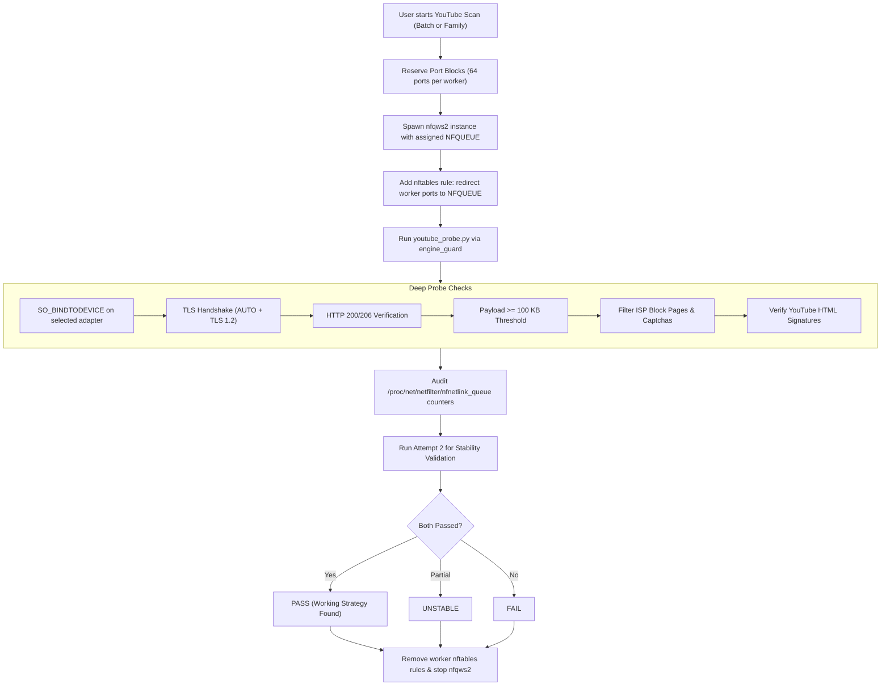

# Project Architecture & Core Value Overview

## 1. Executive Summary

This project (**Igareck AntiDPI**) is built on top of well-known, battle-tested open-source anti-censorship tools—specifically **Bol-Van's Zapret2** (`nfqws2` on Linux, `winws2` on Windows) and **Linux Netfilter** (`nftables` / `NFQUEUE`).

Rather than inventing a new DPI bypass engine from scratch, the primary value-add of this project lies in two components:
1. **The Strategy Matrix:** A curated, categorized library of **484 pre-tuned AntiDPI strategies** across 23 families (Golden & Silver tiers) designed to counter Russian TSPU (ТСПУ) filtering.
2. **The Verification Engine:** An automated, port-isolated, parallel probing engine that scans strategies to discover which specific configurations work on a given ISP or network within minutes.

---

## 2. System Architecture: Layers of the Project

```
+-------------------------------------------------------------------------+
|                        Igareck AntiDPI CLI Layer                        |
|   Interactive Shell, Strategy Selector, Port Manager, Desktop Integration|
+-------------------------------------------------------------------------+
                                    |
                                    v
+-------------------------------------------------------------------------+
|                  Verification & Testing Engine                          |
|   Parallel Scanner, Isolated Port Blocks, Deep TLS/HTML Probe, Audit     |
|   (igareck.py scan() + youtube_probe.py)                                 |
+-------------------------------------------------------------------------+
                                    |
                                    v
+-------------------------------------------------------------------------+
|                     Strategy Matrix (484 Recipes)                       |
|   catalogue.json + actual_tls_guard.lua                                  |
|   Golden Tier (1-45) | Silver Tier (46-484)                             |
+-------------------------------------------------------------------------+
                                    |
                                    v
+-------------------------------------------------------------------------+
|                       Underlying Engine Layer                           |
|   Bol-Van Zapret2 (nfqws2) + Lua Desync Scripts (zapret-lib.lua)         |
+-------------------------------------------------------------------------+
                                    |
                                    v
+-------------------------------------------------------------------------+
|                      OS Kernel Interception                             |
|   Linux Netfilter (nftables, NFQUEUE, conntrack) / WinDivert (Windows)  |
+-------------------------------------------------------------------------+
```

---

## 3. The Strategy Matrix: 484 Curated Recipes in 23 Families

Raw `zapret2` is a low-level framework requiring knowledge of packet fragmentation positions (`pos=...`), TCP sequence manipulation (`seqovl`, `badsum`), fake payload blobs, auto-TTL calculation, and Lua modifiers. Finding the exact working parameters for a specific ISP hardware vendor (e.g. EcoFilter, RDP, etc.) is difficult and time-consuming.

The project abstracts these complex flags into structured profiles defined in [`catalogue.json`](file:///home/dz/tmp/anti-dpi-for-russia/linux/data/catalogue.json):

### A. Golden Tier (Recipes 1–45)
The 45 highest-probability strategies with broad compatibility across Russian ISPs, divided into 5 core families:
1. **fake + multisplit (Recipes 1–13):** Sends an initial fake TLS ClientHello with customized TCP timestamps (`tcp_ts=-1000`), followed by the real ClientHello fragmented across specific points (`pos=1,midsld`).
2. **multisplit + multisplit (Recipes 14–20):** Splits both the fake packet and real packet into multiple segments.
3. **fake + multidisorder (Recipe 21):** Reverses the order of delivered TCP packets to confuse stateful inspection.
4. **Named hostfakesplit (Recipes 22–32):** Injects fake SNI domain fragments (e.g. `host=google.com`) around the real SNI hostname.
5. **Real ClientHello + fake + multisplit (Recipes 33–45):** Uses the user's actual TLS ClientHello as a base, modifies only the SNI field, and transmits it as the desync decoy.

### B. Silver Tier (Recipes 46–484)
439 specialized permutations across 18 families (including `fakeddisorder`, `fakedsplit`, `tcpseg`, and deep payload padding) designed for edge-cases, mobile network DPI, aggressive regional TSPU filtering, and VPN protocol tunneling.

### C. Custom Lua Compatibility Guard (`actual_tls_guard.lua`)
When strategies modify real client traffic using `blob=reasm_data:tls_mod=sni=...`, malformed or non-standard ClientHello packets can crash `nfqws2` or corrupt connections. The author introduced [`actual_tls_guard.lua`](file:///home/dz/tmp/anti-dpi-for-russia/linux/data/actual_tls_guard.lua) to:
- Inspect the raw TLS record structure in Lua before processing.
- Verify TLS version, session ID, cipher suites, compression methods, and SNI extension presence.
- Gracefully fall back to `fake_default_tls` if the packet cannot be safely modified, preventing connection drops.

---

## 4. The Verification Engine (`youtube_probe.py` & `scan()`)

Testing hundreds of strategies manually is impractical. The core diagnostic utility implements an automated, port-isolated laboratory:

### A. Port Block Reservation & Isolated Parallelism
- Supports scanning **1 to 5 strategies in parallel** without mutual interference.
- **Dynamic Port Blocks:** Allocates an exclusive block of 64 ephemeral ports (e.g. `12416–12479`) per concurrent worker.
- **Targeted nftables Interception:** Injects dynamic `nftables` rules redirecting *only* the worker's reserved port block into its dedicated `NFQUEUE`. 

### B. Deep Protocol Verification (Not Just Ping)
[`youtube_probe.py`](file:///home/dz/tmp/anti-dpi-for-russia/linux/app/youtube_probe.py) implements rigorous health checks:
1. **Device Binding:** Uses `SO_BINDTODEVICE` to ensure tests travel across the selected physical interface.
2. **Dual-Mode TLS:** Validates modern TLS with automatic fallback to TLS 1.2 (`AUTO` vs `TLS1.2`).
3. **Block Page & CAPTCHA Detection:** Scans HTTP response bodies against Russian ISP redirect pages and Google bot gates:
   ```python
   re.search(r'''(?is)<(?:form|div)[^>]*(?:id|class)\s*=\s*['" ][^>]*\b(?:g-recaptcha|captcha-form)\b|<form[^>]*action\s*=\s*['"][^'"]*(?:/sorry/|consent\.google\.)''', lower)
   ```
4. **YouTube Signatures:** Confirms presence of real YouTube bootstrap markers: `ytcfg.set`, `ytinitialdata`, `<ytd-app`, `innertube_`.
5. **100 KB Payload Rule:** Requires receiving at least **100 KB** (`THRESHOLD = 100 * 1024`) of payload, proving that video streaming initialization data actually passes rather than failing on subsequent chunk transfers.
6. **Kernel-Level Audit:** Checks `/proc/net/netfilter/nfnetlink_queue` packet counters to guarantee that packets were genuinely intercepted and processed by the strategy under test.
7. **Two-Pass Stability Check:** Runs two attempts per strategy:
   - Both successful = **`PASS`** (displayed in green).
   - One successful = **`UNSTABLE`**.
   - Neither successful = **`FAIL`**.

---

## 5. Verification Pipeline Flow



---

## 6. VPN and Tor Blacklist Use Case

While YouTube bypass can be tested automatically, the repository also targets **Blacklist VPNs (V2Ray, Xray, Shadowsocks, VMess/VLESS) and Tor**:
- In Russia, TSPU filters target specific TLS handshakes and SNIs used by VPN endpoints.
- Users activate a strategy via `START.sh` (or `igareck-antidpi`) and then test their VPN/Tor subscriptions or bridges in their client app.
- A strategy that does not fully restore YouTube may still successfully unblock VPN protocols, and vice versa.
- The project includes [`lists/ips-exclude.txt`](file:///home/dz/tmp/anti-dpi-for-russia/linux/data/lists/ips-exclude.txt) to automatically exclude local LAN and private subnet ranges from interception.
